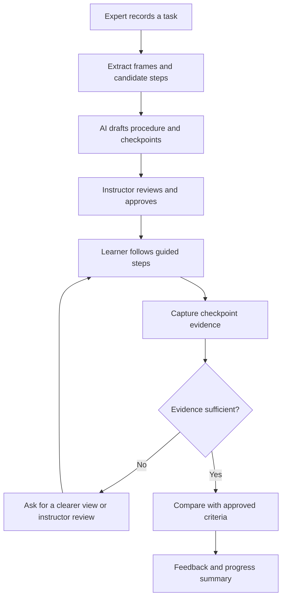

# SkillMirror AI

**Turn one expert demonstration into an interactive, verifiable learning experience.**

SkillMirror AI is a proposed AI-assisted practical-training platform. An instructor records a task, the system helps turn the recording into an editable step-by-step guide, and learners practise the task with visual checkpoints. Where the camera provides enough evidence, computer vision can flag a possible mistake or confirm that an observable step appears complete.

> **Project status:** Hackathon concept / prototype in development. Features described as planned or proposed are not necessarily implemented yet. Any simulated inspection results in a demo must be labelled as simulated.

## The problem

Practical skills are often learned by watching an experienced person, following a manual, and receiving feedback through trial and error. This can make training difficult to scale when experienced instructors have limited time, instructions are inconsistent, or learners need repeated practice.

A video alone usually shows *what* an expert did, but it does not necessarily tell a learner whether their own attempt is correct.

## The solution

SkillMirror AI connects four stages in one workflow:

1. **Record:** Capture an expert demonstrating a clearly defined task.
2. **Structure:** Use AI to draft an ordered procedure, tools/materials list, checkpoints, and likely error points.
3. **Practise:** Give the learner concise instructions and a reference for each step.
4. **Verify:** Compare the learner's attempt with an approved reference or rule, explain possible issues, and ask for another view when the evidence is unclear.

The generated procedure remains editable and should be reviewed by a qualified instructor before it is used for training.

## Core features

### MVP priorities

- **Task setup:** Create a task and describe its expected result.
- **Demonstration intake:** Upload a short video of an expert performing the task.
- **AI-assisted procedure draft:** Extract candidate steps and checkpoints from the demonstration.
- **Instructor review:** Edit, reorder, approve, or remove generated steps before learners use them.
- **Guided practice:** Present one step at a time with concise instructions and reference imagery.
- **Visual checkpoints:** Check selected, observable states against a reference image or deterministic rule where technically feasible.
- **Actionable feedback:** Explain what appears different and how to retry, without pretending to know when visual evidence is insufficient.
- **Progress summary:** Show completed steps, steps needing another attempt, and items requiring instructor review.

### Future enhancements

- Adaptive practice based on recurring learner mistakes.
- Multiple camera angles and improved object/hand tracking.
- Instructor dashboards for multiple learners.
- Task templates for vocational education, repair workshops, makerspaces, and small manufacturers.
- Exportable training guides and assessment reports.
- Support for multiple languages and accessibility options.

## Example use case

A workshop instructor demonstrates how to assemble a simple, non-hazardous mechanical object.

1. The instructor uploads a short demonstration video.
2. SkillMirror drafts an ordered set of steps and suggested checkpoints.
3. The instructor edits and approves the procedure.
4. A learner follows the steps and submits an image or camera frame at a checkpoint.
5. The system returns one of three outcomes:
   - **Appears to pass:** the visible evidence matches the approved criteria closely enough.
   - **Needs another attempt:** a specific, observable difference was detected.
   - **Unable to verify:** the camera view or available evidence is insufficient.
6. The learner receives a progress summary.

The first prototype should use a task whose correctness can be assessed from simple visual evidence. It should not begin with hazardous, medical, electrical, or other safety-critical procedures.

## How it works



## Proposed technology stack

| Layer | Technology | Purpose |
|---|---|---|
| Frontend | React + Vite | Interactive training interface |
| Styling | Tailwind CSS | Responsive UI and reusable components |
| Backend API | Python + FastAPI | Task, media, and verification endpoints |
| Video processing | OpenCV / FFmpeg | Extract representative frames from demonstrations |
| AI assistance | Vision-capable model, selected during implementation | Draft task steps and interpret visual evidence |
| Verification logic | Python rules + image comparison / computer vision | Evaluate clearly defined, observable checkpoints |
| Initial storage | Local files and SQLite, or a configured database | Store task definitions and prototype results |

The exact model provider and storage choice can be changed. Keep extraction, procedure generation, and verification behind separate service interfaces so the application is not tightly coupled to one AI vendor.

## Architecture

```text
React + Vite client
  ├── Task library and task creation
  ├── Instructor procedure editor
  ├── Learner guided-practice view
  └── Checkpoint result and progress summary
              │ HTTP API
              ▼
FastAPI backend
  ├── Task and procedure service
  ├── Media upload and frame extraction
  ├── AI-assisted step extraction
  ├── Checkpoint verification service
  └── Progress/result storage
              │
              ├── Vision model (optional external API)
              ├── OpenCV / image comparison
              └── Local or configured database
```

### Proposed API routes

These routes are a starting design; implement and update this table as the backend evolves.

| Method | Route | Purpose |
|---|---|---|
| `GET` | `/health` | Check that the API is running |
| `POST` | `/tasks` | Create a task |
| `POST` | `/tasks/{task_id}/demonstrations` | Upload a demonstration video |
| `POST` | `/tasks/{task_id}/draft-procedure` | Generate a draft procedure |
| `PUT` | `/tasks/{task_id}/procedure` | Save an instructor-approved procedure |
| `POST` | `/tasks/{task_id}/attempts` | Submit checkpoint evidence for evaluation |
| `GET` | `/tasks/{task_id}/progress` | Retrieve a learner's progress summary |

## Getting started

The commands below describe the intended development setup. They assume the frontend and backend scaffolds have been created; adjust file paths to match the actual repository.

### Prerequisites

- Node.js and npm
- Python 3.10 or newer
- Git
- An API key only if your chosen AI provider requires one

### 1. Clone the repository

```bash
git clone <your-repository-url>
cd skillmirror-ai
```

### 2. Start the backend

```bash
cd backend
python -m venv .venv
```

Activate the environment:

```bash
# Windows PowerShell
.venv\Scripts\Activate.ps1

# macOS / Linux
source .venv/bin/activate
```

Install dependencies and run the API:

```bash
pip install -r requirements.txt
uvicorn app.main:app --reload --port 8000
```

If the entry point differs in your repository, replace `app.main:app` with the actual FastAPI application path.

### 3. Start the frontend

In a second terminal:

```bash
cd frontend
npm install
```

Create `frontend/.env`:

```env
VITE_API_BASE_URL=http://localhost:8000
```

Start Vite:

```bash
npm run dev
```

Open the local URL printed by Vite (typically `http://localhost:5173`). Ensure the backend's CORS configuration allows the frontend origin.

## Suggested project structure

```text
skillmirror-ai/
├── frontend/
│   ├── src/
│   │   ├── components/
│   │   ├── pages/
│   │   ├── services/
│   │   └── App.jsx
│   ├── .env.example
│   └── package.json
├── backend/
│   ├── app/
│   │   ├── api/
│   │   ├── services/
│   │   ├── schemas/
│   │   └── main.py
│   ├── tests/
│   └── requirements.txt
├── docs/
└── README.md
```

This is a suggested structure, not a claim about the repository's current files.

## Environment variables

Keep secrets out of source control. A frontend variable prefixed with `VITE_` is exposed to the browser, so **never put private API keys in frontend environment variables**.

Example frontend `.env.example`:

```env
VITE_API_BASE_URL=http://localhost:8000
```

Keep AI provider credentials on the backend, for example in `backend/.env`:

```env
# Example names; implement these in the backend before use.
AI_PROVIDER_API_KEY=replace-with-your-local-secret
ALLOWED_ORIGINS=http://localhost:5173
```

Add `.env` files and uploaded/private media to `.gitignore`. Do not commit real credentials, private videos, or learner records.

## Three-minute hackathon demo

1. **Show the task:** Introduce a simple assembly or workshop task and its expected result.
2. **Create the guide:** Upload an expert demonstration and show the generated procedure draft.
3. **Review:** Edit and approve the steps, emphasizing that generated instructions require human review.
4. **Attempt:** Submit a correct and an intentionally incorrect checkpoint image.
5. **Verify:** Show the result, evidence-based feedback, or an `Unable to verify` outcome when the image is unclear.
6. **Summarize:** Show the learner's completed steps and retries.

Use a pre-recorded video and prepared test images to make the demo reliable. If any feature is mocked, label it clearly and distinguish the mock from real model inference.

## Safety, privacy, and reliability

- **Human approval:** Generated procedures must be reviewed before learners rely on them.
- **No unsupported pass claims:** If the image does not show enough evidence, return `Unable to verify` rather than guessing.
- **Evidence-linked feedback:** Explain which visible condition led to a result.
- **Start with low-risk tasks:** Do not use an early prototype to certify electrical, medical, industrial-safety, or other high-risk work.
- **Privacy by design:** Collect only media needed for the task, obtain consent from people shown in recordings, set deletion rules, and restrict access to uploaded media.
- **Secure uploads:** Validate file types and sizes, store uploads safely, and avoid exposing media through public URLs by default.
- **Clear limitations:** A visual match is not proof of overall task quality, hidden structural correctness, or safety.
- **Fair evaluation:** Test different lighting, camera angles, backgrounds, and user environments; provide an instructor-review path when results are uncertain.

## Roadmap

- [ ] Scaffold the React frontend and FastAPI backend
- [ ] Build task creation and demonstration upload
- [ ] Extract representative frames from videos
- [ ] Generate an editable draft procedure
- [ ] Add the instructor approval workflow
- [ ] Implement one visual checkpoint for a low-risk task
- [ ] Add pass / retry / unable-to-verify results
- [ ] Create learner progress summaries
- [ ] Add tests for extraction, verification, and failure cases
- [ ] Validate usability with an instructor and learners

## Success metrics to evaluate

Measure the prototype rather than assuming it works:

- Time needed for an instructor to turn a demonstration into an approved guide
- Percentage of generated steps that require substantial correction
- Checkpoint evaluation accuracy on a labelled test set
- Rate of incorrect passes and unnecessary retries
- Whether learners can complete the task with less instructor intervention
- Learner and instructor feedback on clarity and usefulness

For a safety-conscious system, false passes deserve particular attention; report them separately rather than hiding them inside an overall accuracy number.

## Contributing

Contributions are welcome once the initial scaffold is available. Before opening a pull request:

1. Describe the problem the change solves.
2. Include steps to reproduce and verify it.
3. Add tests for new extraction or verification behavior.
4. Never add API secrets, private videos, or real personal data to commits or sample fixtures.

## License

No license is specified yet. Add a `LICENSE` file before distributing or accepting external contributions under an open-source license.

---

**SkillMirror AI — learn by doing, improve through feedback.**
